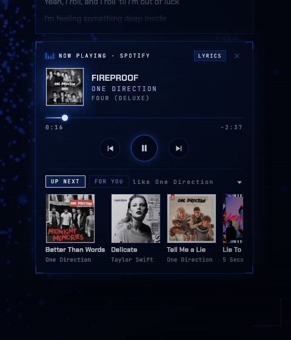
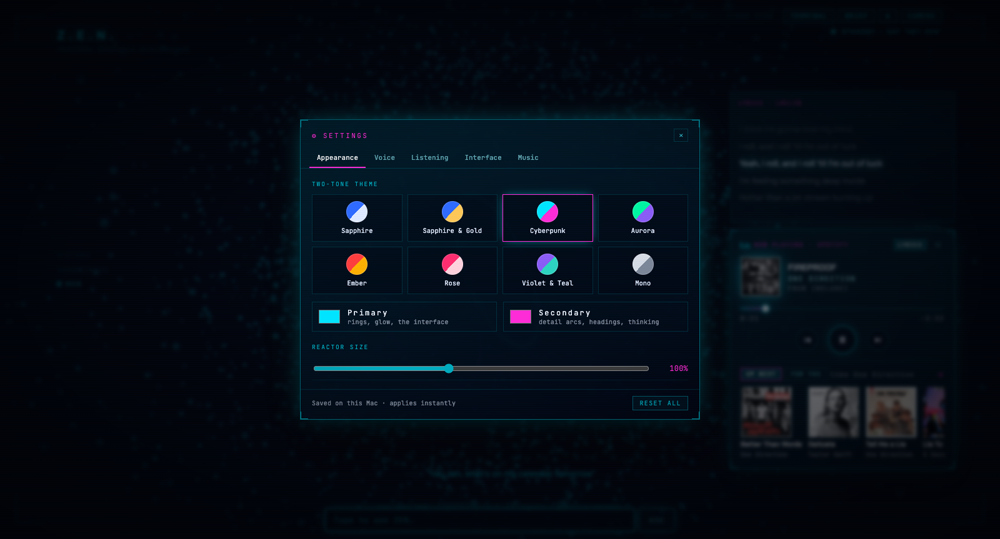

# Z.E.N.

A voice assistant for your Mac with a holographic interface. Say **"Hey Zen"**
(or type) and it answers out loud, puts what it found on screen, plays your
music, opens a terminal, fills in web forms with your permission, and reminds
you of things — while the heavy lifting runs locally on your Mac.

<p align="center">
  
</p>

| | |
|---|---|
|  |  |

ZEN is a fork of [adewaskar/jarvis](https://github.com/adewaskar/jarvis)
(MIT, by Aditya Dewaskar) — see [Credits](#credits).

---

## What it does

- **Talks and listens locally.** Speech-to-text is Whisper large-v3-turbo on
  your Mac's GPU (~0.25 s a phrase, any browser). The voice is
  **Chatterbox Turbo** — natural and expressive (~0.5 s a sentence) — or nine
  faster Kokoro voices (~0.2 s), all on your Mac.
- **Answers and researches.** "Research the EV market in India" fills the
  screen with stat cards, charts, findings and sources. Weather, maths, time,
  dates and unit conversions answer instantly.
- **Your music, without leaving ZEN.** "Play Night Changes" plays it in
  Spotify — hidden in the background — and ZEN shows a holographic player:
  album art, seek bar, synced lyrics, **Up next** and **For you**
  recommendations.
- **Works like a small OS.** "Open terminal" opens a real shell inside ZEN.
  "Open Slack", "volume down", "pause". Timers and reminders with macOS
  notifications.
- **Hands, with permission.** "Fill in this form in Safari" — ZEN reads the
  page and types and clicks, asking you to approve every action first.
- **Remembers.** "Remember I live in Bengaluru." Facts persist between sessions.
- **Yours to style.** Two-tone themes, voices, what's on screen — all in ⚙
  Settings, applied instantly.

---

## Requirements

- **A Mac with Apple Silicon** (M1 or later). The local speech models use the GPU.
- **Node.js 20+** — [nodejs.org](https://nodejs.org) or `brew install node`
- **Homebrew** — [brew.sh](https://brew.sh)
- **uv** (Python tool, for the local voice) — `brew install uv`
- **A brain**, one of:
  - **Claude Code**, installed and logged in (`npm i -g @anthropic-ai/claude-code`, then run `claude` once) — no API key needed, or
  - **any Anthropic-compatible gateway** (for example an org-hosted Kimi), with its URL and token.
- **Optional:** Spotify (free or Premium) for music; Safari for ZEN's hands.

---

## Setup

### 1. Get the code

```bash
git clone https://github.com/RoString36222/better-jarvis-string.git zen
cd zen
npm install
```

### 2. Choose the brain

ZEN reads its settings from `.kimi.env` (git-ignored — your keys never get
committed). Start from the template:

```bash
cp .kimi.env.example .kimi.env
```

- **Using Claude Code?** Leave the brain lines commented out. ZEN uses your
  Claude login.
- **Using a gateway?** Uncomment and fill in `ANTHROPIC_BASE_URL`,
  `ANTHROPIC_AUTH_TOKEN` and `ANTHROPIC_MODEL`, and keep
  `CLAUDE_CODE_DISABLE_EXPERIMENTAL_BETAS=1`.

### 3. Local hearing — Whisper (recommended)

Works in every browser, including Brave and Opera, which block the browser's
own speech recognition.

```bash
brew install whisper-cpp
mkdir -p models
curl -L -o models/ggml-large-v3-turbo-q5_0.bin \
  https://huggingface.co/ggerganov/whisper.cpp/resolve/main/ggml-large-v3-turbo-q5_0.bin
```

The model is ~570 MB and stays in `models/` (git-ignored).

### 4. Local voice — Chatterbox and Kokoro (recommended)

```bash
uv venv .venv-tts --python 3.12
uv pip install --python .venv-tts/bin/python "mlx-audio[server]" "misaki[en]" \
  "en_core_web_sm @ https://github.com/explosion/spacy-models/releases/download/en_core_web_sm-3.8.0/en_core_web_sm-3.8.0-py3-none-any.whl"
```

The first start downloads the voice models (Chatterbox Turbo ~1 GB, Kokoro
~330 MB); after that they run offline. Without this step ZEN falls back to the
browser's voice, which sounds robotic.

### 5. Start ZEN

```bash
./start-kimi.sh
```

It starts the brain bridge, Whisper and the voice together, then serves ZEN at
**http://localhost:5174**. Open that in **Safari or Chrome**, click once
anywhere (browsers only allow sound after a click), and say **"Hey Zen"** — or
type in the box at the bottom.

`Ctrl-C` stops everything.

### 6. The desktop app (optional)

```bash
npm --prefix desktop install
./scripts/install-app.sh
```

This puts **ZEN.app** in Applications. Open it from Launchpad or Spotlight;
it starts ZEN if it isn't running, and **⌥Space** shows or hides it from
anywhere. Closing the window hides it; ⌘Q quits. The first time, allow the
microphone.

---

## Spotify

ZEN never plays audio itself. **Spotify plays, hidden in the background, and
ZEN is the remote**: the holographic player shows the album art, a seek bar,
synced lyrics and recommendations, and controls Spotify from inside ZEN.

### What works without any setup

As long as the Spotify desktop app is installed and you're logged in to it:

- "Play Spotify", "pause", "next song", "previous", "what's playing?"
- the player, seek bar and controls, **synced lyrics**, and **Up next**
  (songs like the one playing)

### Play songs by name, tap recommendations, and "For you"

These need ZEN to search Spotify, which Spotify only allows for a registered
app. It's free, takes two minutes, and does **not** need Premium.

1. **Create a Spotify app.** Go to
   [developer.spotify.com/dashboard](https://developer.spotify.com/dashboard),
   log in with your Spotify account, and click **Create app**:

   | Field | Value |
   |---|---|
   | App name | `ZEN` |
   | App description | `My voice assistant` |
   | Redirect URIs | `http://127.0.0.1:8787/callback` → click **Add** |
   | Which API/SDKs | tick **Web API** |

   Tick the terms checkbox and click **Save**.

2. **Copy the Client ID.** Open the app's **Settings** and copy the
   **Client ID**. You don't need the client secret.

3. **Add it to ZEN.** In `.kimi.env`:

   ```bash
   export SPOTIFY_CLIENT_ID="paste-your-client-id"
   ```

   Restart ZEN (`Ctrl-C`, then `./start-kimi.sh`).

4. **Connect once.** In the player, click **LOG IN WITH SPOTIFY** (or open
   http://127.0.0.1:8787/spotify/login) and click **Agree**. The page says
   *"ZEN is connected to Spotify"* and you can close it.

That's it. Now:

- **"Play Blinding Lights"** finds the track and plays it in the background.
- **Tap any tile** under **Up next** or **For you** to play it.
- **For you** fills with picks based on your top artists lately.

The login is stored in `~/.string/spotify.json` on your Mac only, and ZEN
refreshes it by itself.

### Spotify troubleshooting

| Problem | Fix |
|---|---|
| "INVALID_CLIENT: Invalid redirect URI" | The redirect must be exactly `http://127.0.0.1:8787/callback` — `127.0.0.1`, not `localhost`, no trailing slash. |
| Still shows "Log in with Spotify" | Press ⌘⇧R in ZEN; the status refreshes on reload and when the window regains focus. |
| "Play X" says it needs keys | `SPOTIFY_CLIENT_ID` isn't set, or ZEN wasn't restarted after adding it. |
| Player doesn't appear | It appears while something is playing in the Spotify app. Start a song, or say "play Spotify". |
| Spotify's window pops up | Update ZEN; it launches and hides Spotify in the background. |

---

## ZEN's hands in Safari

ZEN can fill in forms and click things on the page in front of you — always
asking first.

**One-time setup** (Safari blocks this by default):

1. **Safari → Settings… → Advanced** → tick **Show features for web developers**.
2. **Settings → Developer** (or the **Develop** menu) → tick
   **Allow JavaScript from Apple Events**.

Then: *"Fill in the form in Safari: name ZEN, description My voice assistant."*
Safari moves to the right half of the screen so you can watch. For every
action, ZEN shows a card — **ALLOW**, **DENY** or **ALLOW NEXT 2 MIN** — and
does nothing until you answer.

Never done for you, however you ask: agreeing to terms, paying, ordering,
deleting, and password fields. ZEN tells you those are your step.

> Use ZEN.app (not a Safari tab) for these tasks: ZEN acts on whichever Safari
> tab is in front.

---

## Things to say

| You say | ZEN does |
|---|---|
| "What's the weather today?" | Live weather (your home city by default) |
| "What's 15% of 240?" · "Convert 10 km to miles" · "What time is it?" | Answers instantly, no model call |
| "Research the VR headset market" | A wall of stats, charts, findings and sources |
| "Tell me about the Taj Mahal" | Answers, and shows a picture |
| "Play Night Changes" · "Pause" · "Next song" · "What's playing?" | Spotify, in the background |
| "Open terminal" / "Open kitty" | A real shell inside ZEN |
| "Open kitty with Claude Code" · "Ask Claude to explain this repo" | Starts Claude Code in ZEN's terminal and types your message (you approve each one) |
| "Open Slack" · "Volume down" · "Mute" | Opens allowlisted apps, controls volume |
| "Remind me in 20 minutes to check the deploy" · "Ping me at 4" | Spoken reminder + macOS notification |
| "Remember I live in Bengaluru" · "What do you remember?" · "Forget that" | Long-term memory |
| "Stop" · "Wait" · "Zen, …" while it talks | Interrupts it |

Keyboard: **Space** to talk without the wake word · **Esc** to stop ·
**⌥Space** to summon the desktop app.

---

## Settings

Click **⚙** in the toolbar. Everything applies instantly and is saved on your Mac.

- **Appearance** — 8 two-tone themes (Sapphire, Sapphire & Gold, Cyberpunk,
  Aurora, Ember, Rose, Violet & Teal, Mono) or your own primary and secondary
  colours; reactor size.
- **Voice** — Chatterbox Turbo (most natural) or 9 Kokoro voices, British and
  American, with **▶ Preview**.
- **Listening** — how long ZEN keeps listening after answering (0–20 s).
- **Interface** — show or hide the brand, systems list, transcript,
  suggestions and activity badge.
- **Music** — recommendations in the player; lyrics open by default.

### Options in `.kimi.env`

| Variable | What it does |
|---|---|
| `ANTHROPIC_BASE_URL`, `ANTHROPIC_AUTH_TOKEN`, `ANTHROPIC_MODEL` | Use a gateway instead of your Claude login |
| `SPOTIFY_CLIENT_ID` | Spotify search, play by name, recommendations ([Spotify](#spotify)) |
| `SERPER_API_KEY` / `BRAVE_SEARCH_API_KEY` | Real web search for research (otherwise Wikipedia) |
| `STRING_HOME_CITY` | Default city for weather (default Bengaluru) |
| `ZEN_HOTKEY` | Desktop app hotkey (default `Alt+Space`) |

On the command line:

| Command | What it does |
|---|---|
| `JARVIS_MCP=gcp-grafana ./start-kimi.sh` | Also load your Claude Code MCP servers by name (`all` for every one). Adds monitoring tools and proactive alerts; answers get a little slower. |
| `MODEL=… ./start-kimi.sh` | Use a different model for this run |

---

## Privacy and safety

- **Runs on your Mac.** Hearing (Whisper) and voice (Kokoro) are local; your
  audio never leaves the machine. Only your questions go to the model.
- **Only reachable from your Mac.** The bridge listens on `127.0.0.1` and
  only accepts ZEN's own pages.
- **Read-only by default.** ZEN can't run commands or change files. Its Mac
  actions are a fixed list (allowlisted apps, Spotify, volume, reminders);
  Safari actions need your approval each time; the terminal is yours to type
  in, not the model's.
- **Your data stays local**, in `~/.string/`: `memory.json`,
  `reminders.json`, `spotify.json`. Nothing there is in the repo.
- **Keys** live in `.kimi.env`, which is git-ignored.

---

## Troubleshooting

| Problem | Fix |
|---|---|
| ZEN doesn't hear you | Use Whisper (setup step 3). Brave and Opera block browser speech recognition; Safari needs Dictation turned on. Allow the microphone. |
| No sound | Click once anywhere in ZEN — browsers hold sound until you interact. |
| Robotic voice | The local voice isn't set up (step 4), or ZEN wasn't restarted after. |
| "Bridge connection lost" | ZEN is restarting; it reconnects by itself. If it persists, run `./start-kimi.sh` again. |
| Every answer fails | Check the gateway: `curl -H "Authorization: Bearer $ANTHROPIC_AUTH_TOKEN" $ANTHROPIC_BASE_URL/v1/models` should return 200. |
| It answers itself / hears the TV | Lower the follow-up window in Settings → Listening, or use headphones. |
| Safari hands say "blocked" | Turn on **Allow JavaScript from Apple Events** ([setup](#zens-hands-in-safari)). |

---

## Project layout

```
bridge/        Node bridge: the model session, tools, speech, Spotify, terminal
  server.mjs     the bridge and its HTTP/WebSocket routes
  mac.mjs        Mac actions: apps, Spotify, volume, reminders
  music.mjs      recommendations, lyrics, Spotify login
  browser.mjs    Safari hands (approve-every-action)
  memory.mjs     long-term memory
  search.mjs     web search and weather
  zen_pty.py     the terminal's pseudo-terminal
src/           the interface (React + Three.js)
  ui/            reactor, player, terminal, settings, toolbar, panels
  lib/           voice, speech, settings, instant answers
desktop/       the Electron desktop app
scripts/       install-app.sh and helpers
start-kimi.sh  starts everything
```

---

## Credits

ZEN builds on **[adewaskar/jarvis](https://github.com/adewaskar/jarvis)** by
Aditya Dewaskar (MIT) — the original holographic interface and Claude Code
bridge. Its original README is preserved in
[docs/UPSTREAM_README.md](docs/UPSTREAM_README.md). The Chrome speech fix comes
from [erte-del/Jarvis](https://github.com/erte-del/Jarvis).

Also used: [whisper.cpp](https://github.com/ggml-org/whisper.cpp),
[Kokoro](https://huggingface.co/hexgrad/Kokoro-82M) via
[mlx-audio](https://github.com/Blaizzy/mlx-audio),
[xterm.js](https://xtermjs.org), [LRCLIB](https://lrclib.net) lyrics,
[Deezer API](https://developers.deezer.com) recommendations, and
[Open-Meteo](https://open-meteo.com) weather.

The audio in `public/audio/` is cleared for demo use only — see
[public/audio/CREDITS.md](public/audio/CREDITS.md).

MIT licence — see [LICENSE](LICENSE).
